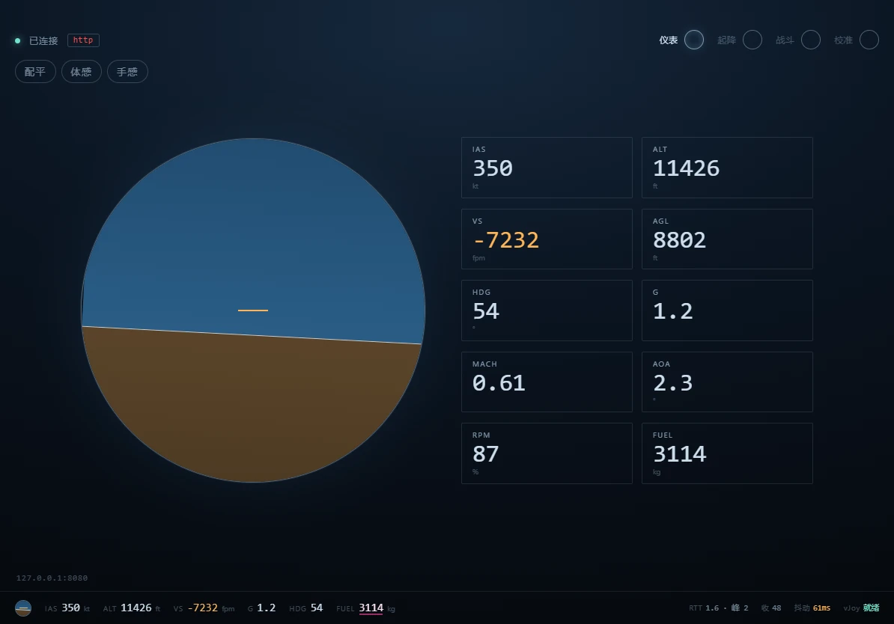
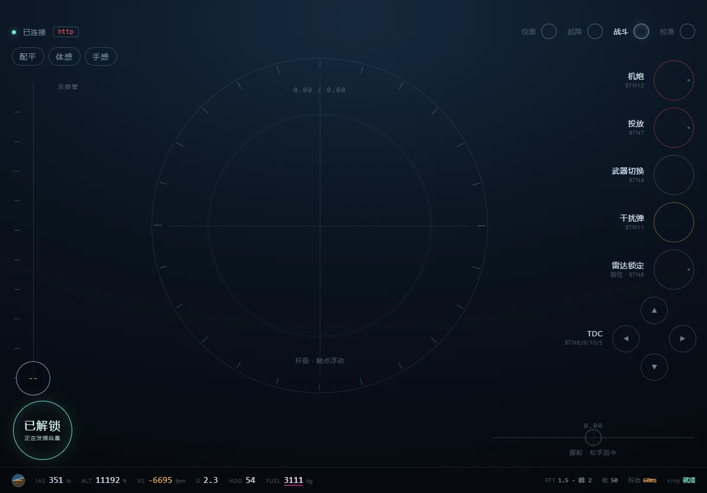

<div align="center">

# 多端 DCS 外设

**把 Pixel 手机变成摇杆，把 iPad 变成仪表盘和座舱控制面板。**

全机型通用 · 单人驾驶 · 不用买额外硬件

[](LICENSE)
[](https://github.com/fengzijie-code/Multi-device-DCS-peripheral/releases/latest)
[](#-快速开始)
[](docs/BINDING.md)

[快速开始](#-快速开始) · [界面](#-界面) · [文档](#-文档) · [更新日志](VERSIONS.md) · [许可](#-许可)

</div>


---

## 📌 这是什么

一套本地跑的三件套：**PC 上三个 Python 进程**，加**一个单文件网页**。
手机或 iPad 打开网页就是操纵面，DCS 的遥测反向往回推。

- **不需要装 app 商店的东西**，iPad 端连安装都不用 —— Safari 打开、「添加到主屏幕」，就是一个全屏窗口。
- **不需要云**，所有数据在 127.0.0.1 和局域网里走。
- **不需要改 DCS**，只在 `Saved Games/DCS/Scripts/` 放一个 `Export.lua`。
- **不绑机型**：操纵最终落到 vJoy 的 4 根轴 + 15 个按钮，DCS 里绑的是「功能」不是某一架飞机，飞什么机型都能用。

### 三条链路

```
遥测   DCS ──UDP:5010──▶ beacon.py:8080 ──HTTP /state──▶ iPad / 手机
操纵   iPad ──HTTP /input──▶ beacon ──UDP:5011──▶ vjoy_out.py ──▶ vJoy ──▶ DCS
座舱   iPad ──HTTP /cmd──▶ beacon ──写文件──▶ Export.lua ──▶ 68 个座舱开关
```

实测 **50.0 Hz**、单帧 **3 ms**、看门狗 **531 ms** 回中。

### 全机型通用到什么程度

杆、油门、脚舵、按钮最后都变成 **vJoy 的 4 根轴 + 15 个按钮**。DCS 里绑的是「Roll / Pitch / Throttle / Flaps」这些功能名，不看机型 —— 所以换飞机不用改一行代码，只需要在 DCS 里照着自己的机型重绑一遍。真正跟机体绑死的只有座舱那一路：

| 链路 | 与机型的关系 | 换机型要做什么 |
|---|---|---|
| **操纵上行**（4 轴 + 15 按钮 → vJoy） | 无关 | 在 DCS 里按[绑键表](docs/BINDING.md)对自己的机型绑一遍 |
| **遥测下行**（IAS / ALT / G / AOA …） | 无关，走 DCS 通用 `LoGet` 接口 | 什么都不用改。个别字段可能为空或量纲不同（油量已按量级自适应，不写死机型） |
| **座舱开关**（`/cmd`，68 个） | **绑死 JF-17** | 要自己从该机型的 `clickabledata.lua` 解析 `device:command`，方法见 [JF-17 控件清单](docs/JF17-CONTROLS.md) |
| **MFD 文本** | 只在 JF-17 上实测过（设备号 8 / 9 / 10） | 其他机型要重新探设备号，且不保证有 indication 文本 |

一句话：**固定翼、直升机都能飞，操纵和遥测天生通用；座舱开关目前只做了 JF-17，别的机型得自己补编号。**

---

## ✨ 特性

| | |
|---|---|
| **遥测下行** | `IAS / ALT / VS / AGL / HDG / G / MACH / AOA / RPM / FUEL`，50 Hz UDP，iPad 侧同时显示数字和姿态球 |
| **操纵上行** | 杆盘（触点浮动 + 位置亮点）、油门（保持）、脚舵（回中）、15 个按钮（含 TDC 四向），50 Hz |
| **安全兜底** | 默认上锁、按钮最短脉冲 120 ms、断线自动上锁、姿态异常兜底 —— 详见 [`docs/YOKE-IPAD.md`](docs/YOKE-IPAD.md) §4 |
| **手感可调** | 死区 / 行程 / expo 三参数 + 配平（force trim）+ 体感（陀螺仪）校零 |
| **一键启动** | 起服务前先查证书、端口、防火墙，起来后印**真实在听**的地址 |
| **两个端互不干扰** | `/input` 是同一个入口，手机和 iPad 可以混着用 |

---

## 🚀 快速开始

### 需要什么

| 必需 | 说明 |
|---|---|
| Windows PC | vJoy 只有 Windows 版，DCS 也在这台机器上 |
| [vJoy](https://sourceforge.net/projects/vjoystick/) 驱动 | 根目录 `vJoySetup.exe`，装一次。**Configure vJoy 里把按钮数设到 ≥ 15**，重启 DCS 生效 |
| DCS World + **任意机型** | 固定翼、直升机都行。操纵与遥测天生通用，只有座舱开关是 JF-17 专属；绑键见[绑键表](docs/BINDING.md) |
| iPad **或** Android 手机 | iPad 走 Wi-Fi（要装一次根证书）；手机走 USB 数据线 |

### 四步

**① DCS 侧** —— 把 `dcs/Export.lua` 复制到 `%USERPROFILE%\Saved Games\DCS\Scripts\`，重进任务。

**② 启动服务** —— 双击对应那个：

```bat
tools\start-ipad.bat     :: iPad 当杆：不需要手机、不建 adb 隧道
tools\start-usb.bat      :: 手机当杆：走 USB，自动建 adb 反向隧道
```

窗口里会逐条打预检结果，最后印出上手地址：

```
[证书] ✓ 有效，还剩 364 天，已含 2 个本机 IP
[端口] ✓ 8080 / 8443 / 5011 都空闲
[防火墙] ✓ 已有放行规则「DCS Peripheral Bridge」
──────────────────────────────────────────────
iPad 打开这一条（地址栏必须带 https://）
  https://192.168.1.42:8443/yoke
自检：http 200  ·  https 200
```

**③ 打开页面** —— 这台机器的地址，见上一步印出来的那一行。没有 DCS 想看效果就加 `mock`：

```bat
tools\start-ipad.bat mock     :: 60 Hz 假遥测，不要和真 DCS 同时开
```

**④ 加进主屏幕**（iPad）—— 分享 → 添加到主屏幕 → 从**桌面图标**启动。
这样才是没有地址栏的全屏窗口。首次要装一次根证书，步骤见 [`docs/YOKE-IPAD.md`](docs/YOKE-IPAD.md) §5。

> **只跑 iPad 那条路的话，Android 端可以完全不管** —— 不用装 APK，不用连数据线。

---

## 🎮 界面

玻璃 HUD 风格：不画面板，只有 1px 细描边、圆、小字距的浅色字。底图是 DCS 座舱，
任何实心色块都会立刻变成"网页控件贴在上面"，所以整页没有一个卡片底色。

<table>
<tr>
<td width="33%"><br><sub><b>起降</b> · 襟翼 / 起落架 / 减速板 / 轮刹</sub></td>
<td width="33%"><br><sub><b>仪表</b> · 姿态球 + 10 个数字</sub></td>
<td width="33%"><br><sub><b>战斗</b> · 机炮 / 投放 / 雷达 / TDC</sub></td>
</tr>
</table>

版位是按**手位**排的，不是按好看排的：

| 位置 | 控件 | 为什么在这儿 |
|---|---|---|
| 中偏左 | 杆盘 | 左右手都能推，换页也不挪位 |
| 左·竖条 | 油门 | 左手大拇指自然落点，松手保持 |
| 右下角 | 脚舵 | 右手管杆盘 + 按钮 + 脚舵，和真机一致 |
| **左下角** | **解锁 / 已解锁（100 px 圆）** | 拇指落下去就够到，不用瞄 |
| 顶部 38 px 以下 | 状态行 / 页签 / 开关 | 让开 iPad 主屏的状态栏（时间、电量） |

---

## 📦 项目结构

```
android/          Android 摇杆 App（Kotlin + Compose，APK 在 release/）
tools/            PC 侧：beacon.py（桥接）、vjoy_out.py（vJoy 输出）、
                  yoke.html（iPad 输入端）、start.py（一键启动）、check-yoke.py（验收）
dcs/              Export.lua —— DCS 侧导出脚本
jf17-trainer/     JF-17 座舱按键训练 + 冷启动流程（机型专用，浏览器打开就能用）
docs/             文档（见下）
release/          按版本归档的 APK
```

---

## 📚 文档

| 文档 | 讲什么 | 什么时候翻 |
|---|---|---|
| **[接手必读](docs/HANDOFF.md)**<br><sub>`docs/HANDOFF.md`</sub> | 当前状态、架构、踩过的坑、下一步 | **第一次进这个仓库就先看它** |
| **[iPad 当杆](docs/YOKE-IPAD.md)**<br><sub>`docs/YOKE-IPAD.md`</sub> | 四页版面、手感、体感与证书、打不开怎么查 | 要上 iPad |
| **[手机摇杆](docs/YOKE.md)**<br><sub>`docs/YOKE.md`</sub> | 页面、配平、USB 链路 | 要上手机 |
| **[仪表盘](docs/PANEL.md)**<br><sub>`docs/PANEL.md`</sub> | 字段含义、三个硬限制 | 看不懂某一个数 |
| **[绑键表](docs/BINDING.md)**<br><sub>`docs/BINDING.md`</sub> | vJoy 轴/按钮 ↔ DCS 功能，怎么绑、反了怎么办 | 第一次进 DCS 绑键 |
| **[遥测实测](docs/DCS-DATA.md)**<br><sub>`docs/DCS-DATA.md`</sub> | DCS 能读到什么、读不到什么 | 想加新字段 |
| **[座舱开关](docs/JF17-CONTROLS.md)**<br><sub>`docs/JF17-CONTROLS.md`</sub> | 68 个可远程操作的开关（**JF-17 专属**，含命令号算法） | 想给别的机型补开关 |
| **[MFD 周边键](docs/JF17-MFD.md)**<br><sub>`docs/JF17-MFD.md`</sub> | U1 / D3 / R8… 的语义（**JF-17 专属**） | 要按 MFD 边框键 |
| **[外设分工](docs/LAYOUT.md)**<br><sub>`docs/LAYOUT.md`</sub> | 什么该上手机、什么该留在座舱 | 想加控件，先定放哪 |
| **[版本历史](VERSIONS.md)**<br><sub>`VERSIONS.md`</sub> | 每一版改了什么、为什么改 | 想知道某个改动从哪来的 |

---

## 🧪 开发与验收

页面不是"看着差不多"就算完 —— `tools/check-yoke.py` 用 playwright + 系统 Chrome，
在 1194×834 的 iPad 横屏视口里**真的发触摸事件**（CDP `Input.dispatchTouchEvent`），
https 下还假造陀螺仪倾斜，然后回头查 `/input` 收到了什么：杆量、轴上是否有 `t`、
按钮 bit、切页后杆心是否挪位、元素有没有溢出视口。

```bat
:: 另起一套隔离端口，别和正在用的 8080 抢 /input
python tools\start.py --port 18080 --udp-in 15010 --tls-port 18443 --vjoy-port 15011 --no-vjoy mock

python tools\check-yoke.py https://127.0.0.1:18443/yoke   :: 74 项
python tools\check-yoke.py http://<本机IP>:18080/yoke      :: 70 项（必须用局域网 IP）
```

当前 **74 / 70 项全过**。

---

## 🚧 已知限制

- **只做横屏**。竖排明确不做 —— 竖起来时杆盘和按键都挤不下。
- **体感必须走 HTTPS**，而且要在 iPad 上装一次根 CA：iOS 不给明文页面的传感器数据。
  证书有效期受 iOS 限制（≤ 398 天），换网段后要重签 leaf（`start.py` 会自动发现）。
- **同时按下的点数贴着 iPad 上限**：推杆 + 油门 + 脚舵 + 按钮一起用时已经满了。
- **单人驾驶场景**，没做多端同步仲裁；两个端同时推会互相覆盖。
- **座舱开关只做了 JF-17**。`/cmd` 里那 68 个编号来自 JF-17 的 `clickabledata.lua`，换机型得自己解析补表（算法写在 [`docs/JF17-CONTROLS.md`](docs/JF17-CONTROLS.md) 开头）。**轴和按钮不受影响**，那两层本来就与机型无关。
- **没有视角轴**。手机端那个「右上角拖拽看四周」的视角区在 v1.2.0 整条链路移除了，见下。

### 没有头瞄（head tracking）怎么办？

手机端的视角拖拽区在 **v1.2.0 被整条移除**（当时的用户换了头瞄），iPad 页面也从来没做过视角。
现在桥接端只认 `x / y / r / t` 四路，**老 APK 发来的 `vx / vy` 会在 beacon 那一层就被丢掉**。

所以想用视角只能**整套回退**到 [`v1.00`](release/v1.00/DCS-Peripheral-v1.00.apk)：
APK 和 `tools/` 一起换，单换 APK 视角不会动。代价是 v1.00 之后的改动全没有 ——
按钮编号调整（`BTN13/14/15`）、战斗页重排与 TDC 四向、倾角过载误判修复、iPad 四页界面。

反过来，**新 APK + 新服务端**是 v1.00 之后所有版本的最优组合，只是没有视角。

---

## 📄 许可

```
MIT License · Copyright (c) 2026 fengzijie
```

可以自由使用、修改、再分发、商用，只需保留版权与许可声明；**不提供任何担保**。
完整条文见 [`LICENSE`](LICENSE)。

仓库里还有两样**不在 MIT 范围内**的东西：

| 文件 | 归属 |
|---|---|
| `DCS JF-17 Thunder Guide.pdf` | 第三方参考资料，版权归原作者；仅作学习参考，不在 MIT 内 |
| `vJoySetup.exe` | 第三方安装包（vJoy，作者 Shaul Eizikovich）。**已被 `.gitignore` 排除，不在仓库里**，只在本地根目录方便安装 |
| DCS World 及各机型模块（含 JF-17） | 商标与版权归 Eagle Dynamics / Deka Ironwork 各自所有，本项目与其无隶属关系 |

要分发本项目，把上面那份 PDF 摘出去即可 —— 它不参与程序运行。

## 🙏 致谢

- [vJoy](https://sourceforge.net/projects/vjoystick/) —— 虚拟摇杆驱动，整条"操纵上行"的最后一步
- [DCS-BIOS](https://github.com/DCS-Skunkworks/DCS-BIOS) —— 调研座舱反向控制时的参照（GPL-3.0），本项目未直接使用其代码

---

<div align="center"><sub>Made for flying with an iPad on the knee.</sub></div>
